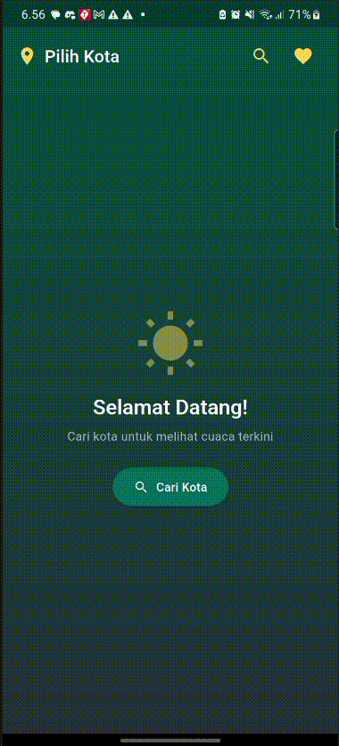
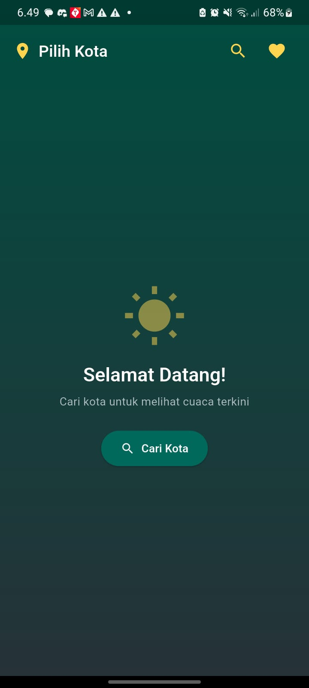
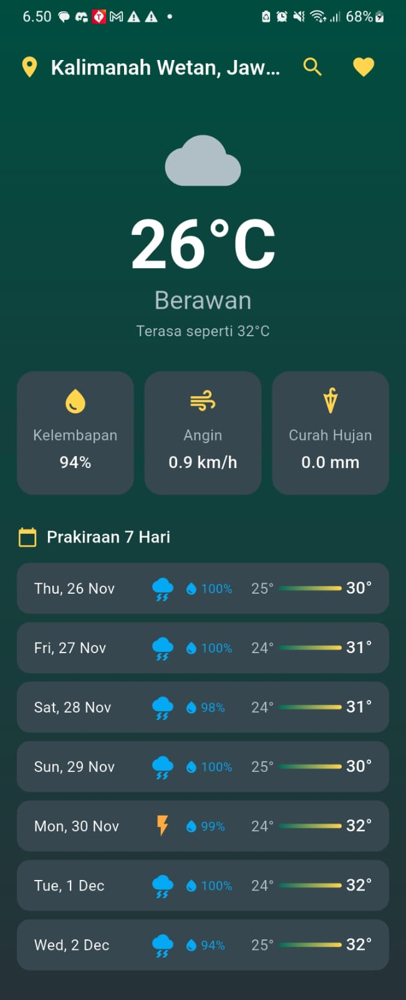
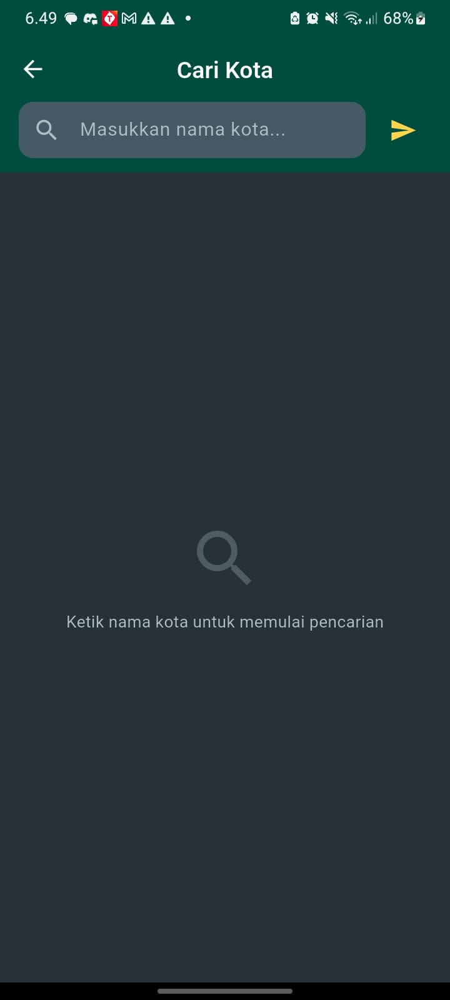
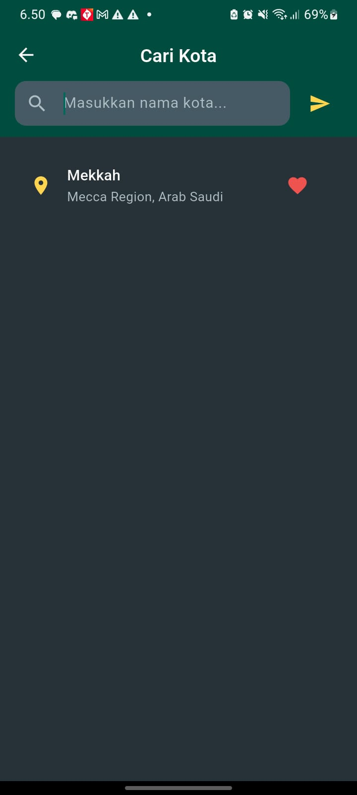
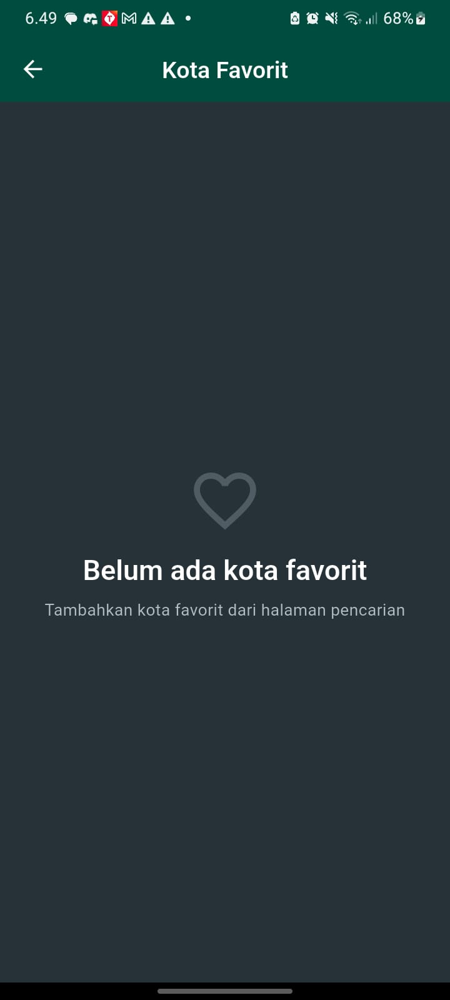
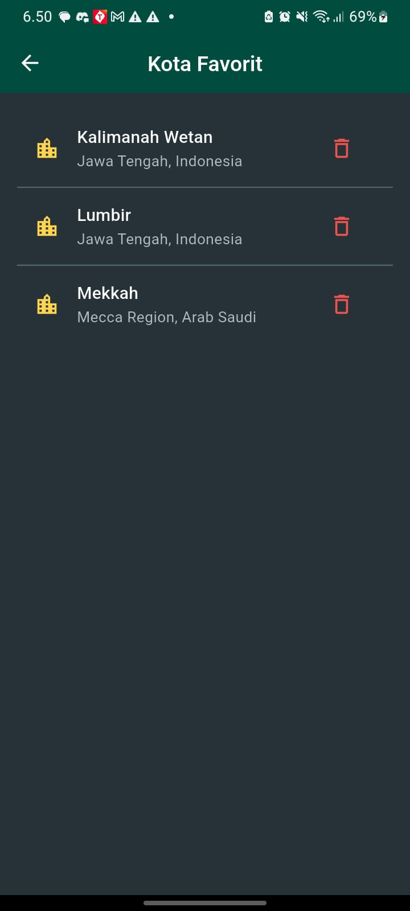

# WeatherApp

> Aplikasi cuaca modern berbasis Flutter yang menampilkan informasi cuaca real-time menggunakan data dari Open-Meteo API.

---

## Deskripsi Aplikasi

**WeatherApp** adalah aplikasi cuaca yang dikembangkan menggunakan **Flutter** dengan bahasa pemrograman **Dart** dan mengikuti pola arsitektur **MVVM (Model-View-ViewModel)**. Aplikasi ini memungkinkan pengguna untuk mencari kota manapun di dunia, melihat kondisi cuaca terkini, prakiraan cuaca harian, serta menyimpan kota favorit untuk akses cepat.

Semua data cuaca diambil secara langsung dari **Open-Meteo API** dan disimpan secara lokal menggunakan **Hive** untuk mendukung pengalaman pengguna yang persisten.

### Fitur Utama

- 🔍 **Pencarian kota** dengan Geocoding API (hasil dalam Bahasa Indonesia)
- 🌡️ **Cuaca terkini**: suhu, kelembapan, kecepatan angin, curah hujan, suhu terasa
- 📅 **Prakiraan 7 hari** dengan suhu min/max dan peluang hujan
- ⭐ **Favorit** — simpan kota favorit dengan Hive, persistent antar sesi
- 🕐 **Riwayat pencarian** — pencarian cepat dari riwayat sebelumnya

---

## Demo Aplikasi



---

## Screenshots

### Home Screen

| Tampilan Kosong (Belum Ada Kota) | Tampilan Dengan Data Cuaca |
|:---:|:---:|
|  |  |

---

### Search Screen

| Tanpa Riwayat Pencarian | Dengan Riwayat Pencarian |
|:---:|:---:|
|  |  |

---

### Favorite Screen

| Belum Ada Favorit | Dengan Kota Favorit |
|:---:|:---:|
|  |  |

---

## Dokumentasi Teknis

### 1. Bahasa Pemrograman & Framework

| Komponen | Teknologi |
|---|---|
| Framework | Flutter 3.x |
| Bahasa | Dart 3.x |
| UI System | Material Design 3 |
| Min SDK Android | 21 (Lollipop) |

Aplikasi ditulis dalam bahasa Dart dan menggunakan widget bawaan Flutter (Material).

---

### 2. Antarmuka Pengguna (UI)

Desain aplikasi menggunakan identitas visual **Deep Teal + Amber**. Seluruh konfigurasi warna dan tipografi dipusatkan di satu file:

```
lib/theme/app_theme.dart
```

| Elemen | Nilai |
|---|---|
| Warna Utama | Deep Teal `#00695C` |
| Aksen | Amber `#FFD54F` |
| Background | Dark Slate `#263238` |
| Surface/Card | `#37474F` |
| Typography | Bold headline, Regular body, 6 varian TextStyle |
| Icon cuaca | Material Icons bawaan Flutter (wb_sunny, cloud, water_drop, dll) |

> **Aturan warna**: Tidak ada `Color(...)` hardcode di widget manapun. Semua warna diambil dari `Theme.of(context).colorScheme.*` atau `theme.textTheme.*`.

---

### 3. List dan Data (Local Storage)

Local storage diimplementasikan menggunakan **Hive**, NoSQL database yang ringan dan cepat untuk Flutter.

```
lib/service/storage_service.dart
lib/model/favorite_model.dart        ← HiveType TypeAdapter
lib/model/favorite_model.g.dart      ← Generated adapter (hand-written)
```

| Hive Box | Tipe | Fungsi |
|---|---|---|
| `favorites` | `Box<FavoriteModel>` | Menyimpan kota favorit (persistent) |
| `search_history` | `Box<String>` | Menyimpan riwayat pencarian |
| `settings` | `Box<String>` | Menyimpan home city yang terakhir dipilih |

Data favorit otomatis dimuat ulang saat aplikasi dibuka kembali. `FavoriteModel` adalah Hive object dengan 6 field (locationId, name, latitude, longitude, country, admin1).

---

### 4. State dan Recomposition

State management menggunakan **Provider** + **ChangeNotifier** secara konsisten di seluruh aplikasi. Tidak ada pencampuran antara `Provider` dan `setState` untuk state yang sama.

```
lib/viewmodel/
├── weather_viewmodel.dart     ← State cuaca (loading, data, error)
├── search_viewmodel.dart      ← State pencarian + riwayat
└── favorite_viewmodel.dart    ← State daftar favorit
```

Setiap ViewModel memiliki **3 state UI**:

```dart
// Contoh dari WeatherViewModel
bool get isLoading => _isLoading;   // → tampilkan CircularProgressIndicator
bool get hasError  => _errorMessage != null; // → tampilkan pesan error + tombol retry
bool get hasData   => _weather != null;      // → tampilkan konten cuaca
```

Provider diregistrasikan di `app.dart` menggunakan `MultiProvider`:

```dart
MultiProvider(
  providers: [
    ChangeNotifierProvider(create: (_) => WeatherViewModel(...)),
    ChangeNotifierProvider(create: (_) => SearchViewModel(...)),
    ChangeNotifierProvider(create: (_) => FavoriteViewModel(...)),
  ],
  child: MaterialApp(...),
)
```

---

### 5. Networking & API

#### Library
```yaml
http: ^1.4.0   # HTTP GET request
```

Semua request HTTP dilakukan **hanya di service layer** (`ApiService`). Tidak ada widget yang langsung melakukan HTTP call.

```
lib/service/api_service.dart
```

#### Implementasi API Open-Meteo

**Langkah 1 — Geocoding API** (cari kota berdasarkan nama)
```
GET https://geocoding-api.open-meteo.com/v1/search
    ?name={kota}
    &count=10
    &language=id
    &format=json
```

**Langkah 2 — Forecast API** (ambil cuaca berdasarkan koordinat)
```
GET https://api.open-meteo.com/v1/forecast
    ?latitude={lat}
    &longitude={lon}
    &current=temperature_2m,relative_humidity_2m,apparent_temperature,
             precipitation,weather_code,wind_speed_10m
    &daily=temperature_2m_max,temperature_2m_min,
           precipitation_probability_max,weather_code
    &timezone=auto
```

#### Parsing JSON → Model Dart (Manual)

Tidak menggunakan code-generation untuk parsing. Setiap model memiliki factory constructor `fromJson()`:

```dart
factory WeatherModel.fromJson(Map<String, dynamic> json) {
  final currentJson = json['current'] as Map<String, dynamic>;
  final dailyJson   = json['daily']   as Map<String, dynamic>;
  // ... parsing manual
}
```

#### Field API Wajib

| Field API | Model Dart | Ditampilkan Di |
|---|---|---|
| `current.temperature_2m` | `temperature` | Suhu utama (besar) |
| `current.relative_humidity_2m` | `relativeHumidity` | Card Kelembapan |
| `current.apparent_temperature` | `apparentTemperature` | "Terasa seperti X°C" |
| `current.precipitation` | `precipitation` | Card Curah Hujan |
| `current.weather_code` | `weatherCode` | Icon + Deskripsi cuaca |
| `current.wind_speed_10m` | `windSpeed` | Card Kecepatan Angin |
| `daily.temperature_2m_max` | `temperatureMax` | Baris forecast harian |
| `daily.temperature_2m_min` | `temperatureMin` | Baris forecast harian |
| `daily.precipitation_probability_max` | `precipitationProbabilityMax` | % hujan harian |

---

### 6. Arsitektur MVVM

```
lib/
├── main.dart                        # Entry point: Hive init + runApp
├── app.dart                         # MultiProvider + MaterialApp
│
├── model/                           # DATA CLASS — hanya fromJson/toJson
│   ├── weather_model.dart           # WeatherModel, CurrentWeather, DailyWeather
│   ├── location_model.dart          # LocationModel (hasil Geocoding)
│   ├── favorite_model.dart          # FavoriteModel (Hive HiveObject)
│   └── favorite_model.g.dart        # Hive TypeAdapter
│
├── service/                         # SERVICE — hanya API & storage
│   ├── api_service.dart             # HTTP GET ke Open-Meteo
│   └── storage_service.dart         # Hive CRUD (favorites, history, settings)
│
├── viewmodel/                       # VIEWMODEL — state + logic, ChangeNotifier
│   ├── weather_viewmodel.dart       # fetchWeather, loadHomeCity, retry
│   ├── search_viewmodel.dart        # searchLocation, loadSearchHistory, clearHistory
│   └── favorite_viewmodel.dart      # loadFavorites, toggleFavorite, removeFavorite
│
├── view/                            # VIEW — hanya UI widget, no HTTP call
│   ├── home_screen.dart             # Cuaca terkini + daily forecast
│   ├── search_screen.dart           # Pencarian kota + riwayat
│   ├── favorite_screen.dart         # Daftar kota favorit
│   └── widgets/
│       ├── weather_icon_helper.dart  # WMO code → icon, deskripsi, warna
│       ├── weather_detail_card.dart  # Card detail (kelembapan, angin, dll)
│       └── daily_forecast_card.dart  # Baris prakiraan harian
│
└── theme/
    └── app_theme.dart               # ThemeData global
```

**Aturan ketat MVVM:**
- `model/` → **tidak boleh** import Flutter widget
- `view/` → **tidak boleh** ada `http.get(...)` atau logika bisnis
- `viewmodel/` → **tidak boleh** ada widget; extends `ChangeNotifier`
- `service/` → **tidak boleh** ada widget; dipanggil hanya dari ViewModel

---

### 7. Screen dan Navigasi

```
HomeScreen (root)
    │
    ├──[icon search]──► SearchScreen
    │                       │
    │                       └── pilih kota ──► pop ke HomeScreen + fetch cuaca
    │
    └──[icon favorit]──► FavoriteScreen
                             │
                             └── pilih kota ──► pop ke HomeScreen + fetch cuaca
```

| Screen | Widget Type | Fungsi Utama |
|---|---|---|
| `HomeScreen` | StatefulWidget | Tampilkan cuaca kota aktif, loading/error/empty state |
| `SearchScreen` | StatefulWidget | Cari kota, tampilkan hasil, simpan favorit, riwayat |
| `FavoriteScreen` | StatefulWidget | Daftar favorit, pilih kota, hapus favorit (long-press / tombol delete) |
| `WeatherDetailCard` | StatelessWidget | Reusable card untuk detail cuaca (icon + label + nilai) |
| `DailyForecastCard` | StatelessWidget | Baris forecast harian (hari, icon, peluang hujan, min/max) |

**Navigasi** menggunakan `Navigator.push()` dan `Navigator.popUntil(isFirst)` — tidak menggunakan named routes agar tetap sederhana dan mudah ditelusuri.

---

## Dependencies

```yaml
dependencies:
  provider: ^6.1.2        # State management
  http: ^1.4.0            # HTTP client
  hive: ^2.2.3            # Local database
  hive_flutter: ^1.1.0    # Hive adapter untuk Flutter
  intl: ^0.19.0           # Format tanggal (EEE, d MMM)

dev_dependencies:
  hive_generator: ^2.0.1  # Generator Hive TypeAdapter
  build_runner: ^2.4.9    # Code generation runner
```

---

## Cara Menjalankan

```bash
# 1. Clone atau buka project
cd weather_app

# 2. Install dependencies
flutter pub get

# 3. Jalankan aplikasi
flutter run
```

---

## 🔗 Referensi API

- [Open-Meteo Forecast API](https://open-meteo.com/en/docs)
- [Open-Meteo Geocoding API](https://open-meteo.com/en/docs/geocoding-api)
